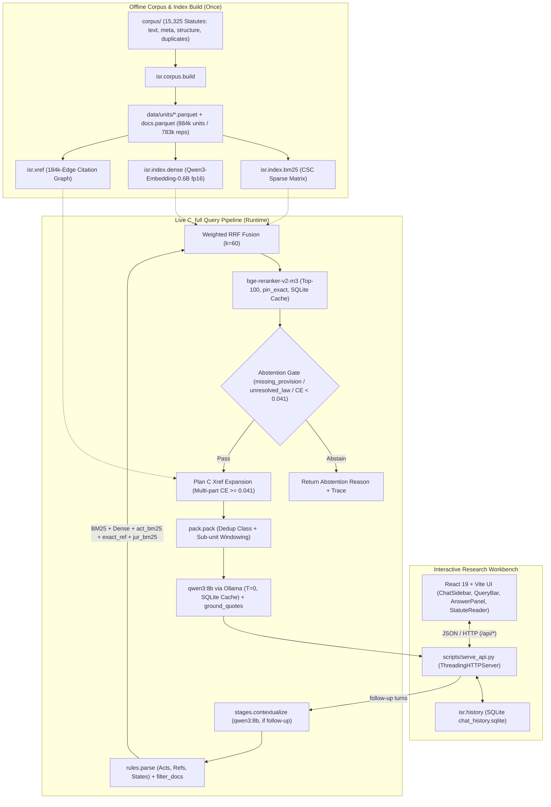

# CaseWise (`isr`) — Structure-Aware Local RAG for Indian Statutory Law

**Fully local, structure-aware Retrieval-Augmented Generation (RAG) engine and full-stack legal research workbench over 15,325 Indian statutory instruments — running on a single consumer laptop with open models and zero external APIs.**

[](pyproject.toml)
[](requirements.txt)
[](frontend/package.json)
[](frontend/vite.config.js)
[](frontend/src/index.css)
[](configs/C_full.yaml)
[](runs/final/REPORT.md)

<!-- Replace with a screenshot of the split-pane legal research workbench (`frontend/`) once captured -->
> _Screenshot placeholder: Split-pane legal research interface with persistent Chat History sidebar, grounded Answer Panel with highlighted statutory quotes, and interactive Statute Reader with cross-reference navigation._

---

## 1. Overview

### Problem
Standard RAG pipelines fail on statutory law for four concrete reasons:
1. **Arbitrary chunking breaks legal logic:** Fixed-size token windows slice sections, provisos, and exceptions in half.
2. **Duplicate statutes waste context budget:** Central Acts, State adaptations, and parallel copies repeat identical provisions, crowding out distinct authority under tight character budgets.
3. **Multi-provision & situational queries:** Legal questions often describe a fact pattern without naming the Act (`situational`), target a specific State's version (`jurisdictional`), or require multiple sections that cite each other (`cross_reference`).
4. **Unverifiable or unsafe answers:** General LLMs invent section numbers, mis-cite statutes, or guess on unanswerable queries (foreign law, case law, or non-existent sections).

### Solution & Intended Users
**CaseWise** (`isr` — Indian Statutory RAG) solves these problems by aligning retrieval units to parsed statutory structure, combining lexical + dense retrieval with deterministic legal rules and cross-encoder reranking, expanding multi-part queries across a **184k-edge provision citation graph**, refusing unanswerable questions via calibrated abstention, and generating answers whose citations and verbatim quotes are verified post-hoc against the retrieved statute text.

It is built for **legal researchers, law students, practitioners, and AI/NLP engineers** who need exact statutory provenance, full-document reading, and complete on-premise data privacy with zero cloud API costs.

### Key Differentiators
* **3.1× higher recall than BM25 on IndiaStatRAG** (`0.757` vs `0.242` macro evidence recall at an 8,000-char budget on 352 frozen test questions).
* **Zero hallucinated citations:** Across `450` citations emitted by the frozen final system (`C-full`) on the test split, `0` pointed to non-existent provisions or out-of-context documents, and `100%` of scored quotes matched the cited source verbatim.
* **Evidence-backed ablations (`plan.md`):** Tested five LLM-in-retrieval techniques (query analysis, HyDE, pointwise LLM rerank, LLM abstention judge, and a ReAct agent) on a separate `dev_tune` split and **dropped** those that added latency without statistically significant gains.
* **Consumer-hardware friendly:** Runs offline evaluation via a staged batch pipeline on 8 GB VRAM, and runs interactive web queries via CPU-backed dense vectors (`CpuDenseIndex`), automatic VRAM-aware reranker placement (`ISR_RERANK_DEVICE=auto`), and SQLite response caching.

---

## 2. Features

### Retrieval & Generation Engine (`src/isr/`)
* **Structure-Aware Unit Store & Deduplication (`isr.corpus.units`, `isr.corpus.build`, `isr.store`):**
  * Indexes **15,325 India Code documents** (~712.8M chars) into **884,128 units**: exact **provisions** (sections/articles), **sub-units** (provisions `> 2,000` chars tiled along subsections/clauses), and **gap windows** (`1,200`-char windows / `900` stride over preambles, schedules, and unparsed text).
  * Deduplicates identical normalized text within duplicate clusters (`duplicates.json`), indexing **783,706 class representatives** while keeping every copy's exact character offsets into `corpus/text/<document_id>.txt`.
* **Hybrid Retrieval + Rule Signals + Cross-Encoder Reranking (`isr.pipeline`, `isr.query.rules`, `isr.retrieve.rerank`):**
  * Fuses Lucene **BM25** (`indexes/bm25_units/`) and **fp16 dense embeddings** (`Qwen/Qwen3-Embedding-0.6B`) via weighted **Reciprocal Rank Fusion (RRF, `k=60`)**.
  * Extracts Indian Act titles + years, section/rule/article references, and 36 State/UT jurisdictions (+ aliases) via a regex/gazetteer parser to inject `act_bm25`, `jur_bm25`, and pinned `exact_ref` matches.
  * Reranks the top 100 candidates with **`BAAI/bge-reranker-v2-m3`** backed by a persistent SQLite score cache (`data/cache/rerank_bge-reranker-v2-m3.sqlite`).
* **Provision Cross-Reference Expansion (`isr.xref`, Plan `C3e`):**
  * Builds a **184k-edge** intra-Act and Rule/Regulation $\to$ parent-Act citation graph.
  * For multi-part questions (`question_parts`), inspects outgoing and incoming citation edges of top hits and promotes neighbor provisions whose best sub-question cross-encoder score passes `0.041` — lifting `cross_reference` all-groups recall from `0.314` to **`0.490`** ($p = 0.002$) with zero regressions on other categories.
* **Calibrated Abstention (`isr.pipeline.rule_abstain_reason`):**
  * Refuses to answer (`[]`) on `missing_provision` (named Act exists, cited section number does not), `unresolved_law` (named law phrase absent from the corpus), `low_rerank_score` (top cross-encoder score `< 0.041`), or `filter_empty` — achieving **`0.771`** unanswerable abstention at **`0.032`** false abstention on test.
* **Budget Packer & Quote-Grounded Synthesis (`isr.pack`, `isr.llm.client`, `isr.llm.stages`):**
  * Packs non-duplicate spans within `2,000` / `8,000` / `32,000` character budgets, centering truncated long provisions on the best-ranked sub-unit.
  * Calls local **`qwen3:8b`** via Ollama (`temperature=0`, `seed=20261117`, `num_ctx=8192`, thinking off) with JSON-schema enforcement and a content-addressed SQLite cache (`data/cache/llm.sqlite`).
  * Post-processes answers with `ground_quotes` so only verbatim strings ($\ge 12$ chars) verified inside the *cited* provisions retain double quotes.

### Full-Stack Web Workbench (`scripts/serve_api.py` + `frontend/`)
* **Live Query API & Demo Fallback:** `ThreadingHTTPServer` (`scripts/serve_api.py`) exposes `/api/health`, `/api/filters`, `/api/examples`, `/api/report`, `/api/document`, `/api/provision`, `/api/query`, and `/api/chats*`, and serves `frontend/dist/` in production.
* **True Metadata Filtering & Budget Control:** Restricts retrieval (`allowed_docs` + dedup member override) by Jurisdiction (`All`, `Central` $\to$ `India`, or any State/UT), Instrument Type (`Central Act`, `State Act`, `Rule`, `Regulation`), and context budget (`2k` / `8k` / `32k` chars).
* **Persistent Multi-Turn Chat History (`isr.history`):** SQLite-backed conversation threads (`data/chat_history.sqlite`) with sidebar management (create, auto-title, rename, delete, clear, `localStorage` active-chat restore) and LLM follow-up contextualization (`contextualize-v1`) when queries reference prior turns.
* **Interactive Split-Pane UI (`React 19 + Tailwind CSS v4`):**
  * **Answer Panel:** Highlights verbatim statutory quotes, displays clickable `[1]`, `[2]` citation chips, latency, contextualized query preview, collapsible **Retrieval Details** (`trace`), Copy Answer, and **Export Memo** (`.md`).
  * **Statute Reader:** Renders full passage metadata, **Read Surrounding Sections** (`GET /api/document` with offset windowing supporting Acts of any length), and **clickable Cross-References** (`GET /api/provision`) with navigation history stack.

---

## 3. Architecture

### System Overview & Data Flow

The codebase operates in three complementary modes sharing the same `UnitStore`, `Pipeline`, `Pack`, and `LLM` modules:
1. **Offline Index Build (once):** `corpus/` $\to$ `isr.corpus.build` (`data/units/*.parquet`, `data/docs.parquet`) $\to$ `isr.index.bm25`, `isr.index.dense`, and `isr.xref`.
2. **Interactive Web Workbench (`scripts/serve_api.py` + `frontend/`):** Uses `CpuDenseIndex` (fp32 vectors in RAM) so the GPU stays available for Ollama (`qwen3:8b`), with `ISR_RERANK_DEVICE=auto` placing `bge-reranker-v2-m3` on CPU when VRAM `< 5 GiB` (e.g. 4 GB RTX 3050) or CUDA otherwise. User turns are persisted in `data/chat_history.sqlite`.
3. **Staged Batch Evaluation (`scripts/run_system.py`, `scripts/run_b.py`, `scripts/phase5.py`):** Stages GPU retrieval and Ollama inference sequentially so both fit on a single 8 GB GPU, writing predictions scored by the pinned `benchmark_kit/` scorer (`isr.eval.evaluate`).



---

## 4. Tech Stack

| Technology | Purpose | Where / How Used |
|---|---|---|
| **Python 3.12** | Core backend, indexing & evaluation runtime | `src/isr/`, `scripts/`, `benchmark_kit/` |
| **PyTorch (`torch==2.13.0`)** | Tensor math & CUDA/CPU model inference | GPU/CPU dense matmul & CrossEncoder (`src/isr/index/dense.py`, `src/isr/retrieve/rerank.py`) |
| **Sentence-Transformers & Transformers** | Bi-encoder embeddings & cross-encoder reranking | `Qwen/Qwen3-Embedding-0.6B` & `BAAI/bge-reranker-v2-m3` |
| **Ollama (`qwen3:8b` Q4_K_M)** | Local LLM inference (no cloud APIs) | Answer generation & follow-up contextualization via HTTP (`src/isr/llm/client.py`, `stages.py`) |
| **bm25s, PyStemmer, SciPy** | Tokenization, Snowball stemming & sparse BM25 | Stopword/stemming tokenizer (`src/isr/text.py`) & CSC BM25 matrix (`src/isr/index/bm25.py`) |
| **NumPy, Pandas, PyArrow** | Unit metadata, parquet storage & CPU dense search | `data/units/*.parquet`, `docs.parquet`, `UnitStore`, `CpuDenseIndex` |
| **orjson, PyYAML, rapidfuzz** | Fast corpus JSON parsing & YAML configs | `src/isr/corpus/build.py`, `configs/*.yaml` |
| **SQLite (`sqlite3`)** | Persistent caching & chat history storage | `data/chat_history.sqlite`, `data/cache/llm.sqlite`, `data/cache/rerank_*.sqlite` |
| **Python `http.server`** | Lightweight threaded REST API + SPA static server | `scripts/serve_api.py` |
| **React 19, Vite, Tailwind CSS v4** | Split-pane legal research frontend | `frontend/src/` (`App.jsx`, `ChatSidebar`, `QueryBar`, `AnswerPanel`, `StatuteReader`) |
| **lucide-react** | UI iconography | `frontend/src/components/*.jsx` |
| **pytest** | Unit & HTTP API integration tests | `tests/` (43 tests across unit store, packer, xref, quote grounding, eval, and API/history) |

---

## 5. Installation and Setup

### Prerequisites
* **OS:** Windows 11 (or Linux/macOS with matching Python/PyTorch wheel)
* **Python:** `3.11+` (tested on `3.12.0` / `3.12.4`)
* **Node.js & npm:** Node `18+` (tested with Node `v24.3.0`, npm `11.4.2`) for the frontend
* **Ollama:** Installed locally (`ollama serve` or Ollama Desktop) with `qwen3:8b` pulled
* **Hardware:**
  * *Interactive Web App:* ~16 GB RAM recommended (`CpuDenseIndex` holds ~3.2 GB fp32 vectors in RAM); works on 4 GB+ GPUs (`--rerank-device auto` automatically runs the reranker on CPU when GPU VRAM `< 5 GiB`).
  * *Full Dense Index Build / Batch Eval:* CUDA GPU (e.g., RTX 4060 8 GB takes ~7.7 h for full corpus encoding; use `--batch 8` on 4 GB GPUs).
* **Disk space:** ~30 GB free for corpus, unit store, indexes, Hugging Face weights, and Ollama model.

---

### Step 1: Clone the Repository
```powershell
git clone https://github.com/Shreejith-19/case-wise.git
cd case-wise
```

---

### Step 2: Python Virtual Environment & Dependencies
```powershell
python -m venv .venv
.venv\Scripts\Activate.ps1

# Install PyTorch (CUDA 13.0 wheel per requirements.txt; use cu124/cu126 if required by your driver)
pip install torch==2.13.0 --index-url https://download.pytorch.org/whl/cu130
pip install -r requirements.txt
pip install -e .
```
*(Exact frozen package versions are recorded in `requirements.lock.txt`.)*

---

### Step 3: Frontend Setup & Production Build
```powershell
cd frontend
npm install
npm run build
cd ..
```

---

### Step 4: Ollama & Model Setup
Pull the local LLM configured in [configs/C_full.yaml](configs/C_full.yaml) and ensure Ollama is running:
```powershell
ollama pull qwen3:8b
ollama serve   # skip if the Ollama desktop app is already running
```
*(Embedding and reranker weights—`Qwen/Qwen3-Embedding-0.6B` and `BAAI/bge-reranker-v2-m3`—are downloaded automatically from Hugging Face on first use.)*

---

### Step 5: Environment Variables
No `.env` file or API keys are required. Optional runtime variable:

| Variable | Values | Default | Description |
|---|---|---|---|
| `ISR_RERANK_DEVICE` | `auto`, `cuda`, `cpu` | `auto` | Controls where `BAAI/bge-reranker-v2-m3` runs in `serve_api.py`. `auto` uses `cpu` when GPU VRAM `< 5 GiB` so Ollama keeps the GPU. |

---

### Step 6: Knowledge Base (`corpus/`) & Index Initialization

`corpus/`, `data/`, and `indexes/` are git-ignored. Place the published IndiaStatRAG corpus directly at `case-wise/corpus/` (`documents.jsonl`, `CHECKSUMS.txt`, `duplicates.json`, `text/`, `meta/`, `structure/`), then build the derived unit store and indexes once:

```powershell
python -m isr.corpus.build                          # -> data/units/*.parquet, data/docs.parquet    (~1-5 min)
python -m isr.index.bm25 build                      # -> indexes/bm25_units/                        (~1 min)
python -m isr.index.dense build --model qwen3-0.6b  # -> indexes/dense_qwen3-0.6b/ (use --batch 8 on 4 GB VRAM)
python -m isr.xref build                            # -> indexes/xref/                              (~3 min)
```

* Long index builds (`isr.index.dense`, `isr.xref`, `isr.acts`) support **cooperative pause/resume**: create an empty `PAUSE` file in the repo root (`New-Item PAUSE`) to stop cleanly after the current shard/chunk (exit code `3`), then delete `PAUSE` and re-run the same command to continue.
* SQLite databases (`data/chat_history.sqlite`, `data/cache/llm.sqlite`, `data/cache/rerank_bge-reranker-v2-m3.sqlite`) are initialized automatically at runtime.

---

## 6. Running the Application & Tests

### Web Interface (Development)
Run the API bridge and Vite dev server in separate terminals:
```powershell
# Terminal 1 — API Bridge (http://127.0.0.1:8000)
.venv\Scripts\python scripts\serve_api.py --host 127.0.0.1 --port 8000

# Terminal 2 — React Dev Server (http://localhost:5173, proxies /api -> :8000)
cd frontend
npm run dev
```
*(If `corpus/` is not yet present, the API runs in **Demo Mode**, serving `/api/health`, `/api/examples`, `/api/report`, and persistent `/api/chats*` history while returning `503` on live `/api/query`.)*

### Web Interface (Single-Server Production Mode)
Once `frontend/dist/` is built (`npm run build`), `serve_api.py` serves both the API and the React SPA at `http://127.0.0.1:8000`:
```powershell
.venv\Scripts\python scripts\serve_api.py --preload
```

### Interactive CLI Chatbot
```powershell
.venv\Scripts\python scripts\chat.py
# Commands inside the REPL: :sources, :why, :quit
```

### Running Tests
```powershell
.venv\Scripts\python -m pytest -q
```
Covers unit invariants (`test_units.py`, `test_unit_store.py`), budget packing & RRF (`test_pack.py`), abstention rules (`test_rule_abstain.py`), cross-reference regex extraction (`test_xref.py`), quote grounding (`test_ground_quotes.py`), evaluation/logging (`test_eval.py`, `test_eval_log.py`), and `ChatStore` + HTTP API routes (`test_history_and_api.py`).

---

## 7. Benchmark Results (`IndiaStatRAG` Test Split)

Evaluated once per frozen system on the 352-question test split (`B = 8,000` chars, `τ = 0.5`; full breakdowns and paired bootstrap CIs in [runs/final/REPORT.md](runs/final/REPORT.md) and [plan.md](plan.md)):

| System | Config | Macro Evidence Recall | Cross-Ref All-Groups | Abstention / False Abstention | Answer Fact Coverage |
|---|---|---:|---:|---|---:|
| `bm25-two-stage` (baseline) | — | 0.242 | 0.098 | 0.000 / 0.000 | — |
| Dense only (`Qwen3-Embedding-0.6B`) | [configs/A1d.yaml](configs/A1d.yaml) | 0.649 | 0.333 | 0.000 / 0.000 | — |
| **Plan A** — hybrid + rules + rerank + abstention | [configs/A_full.yaml](configs/A_full.yaml) | 0.747 | 0.314 | 0.771 / 0.032 | — |
| **Plan B** — Plan A + `qwen3:8b` cited answers | [configs/B_full.yaml](configs/B_full.yaml) | 0.747 | 0.314 | 0.771 / 0.032 | 0.709 |
| **Plan C** — Plan B + cross-ref expansion (frozen) | [configs/C_full.yaml](configs/C_full.yaml) | **0.757** | **0.490** | **0.771 / 0.032** | **0.722** |

To reproduce the frozen evaluation runs (requires the pinned `Indian-legal-benchmark` commit `b45befa5fa7f6242dbe9b15cf7b496a0be80921a` for BM25 baselines):
```powershell
git checkout phase5-frozen
python scripts/phase5.py status
python scripts/phase5.py run
python scripts/phase5_analysis.py
```

---

## 8. Repository Layout

```text
case-wise/
├── configs/               # System & ablation YAMLs (frozen: A_full, B_full, C_full; post-test: C_LS; dev agent: E)
├── src/isr/
│   ├── corpus/            # Unit builder (provisions, sub-units, gap windows, dedup classes)
│   ├── index/             # Sparse BM25 CSC index, GPU fp16 dense index, CPU RAM dense index
│   ├── query/             # Deterministic Act/section/jurisdiction rule parser
│   ├── retrieve/          # Cross-encoder reranker with device auto-selection & SQLite cache
│   ├── llm/               # Ollama client with content-addressed SQLite cache & LLM stages
│   ├── eval/              # IndiaStatRAG scorer wrapper, bootstrap CIs, run logging
│   ├── pipeline.py        # Hybrid fusion, metadata scoping, filtering, abstention, xref expansion
│   ├── pack.py            # Dedup- and sub-unit-aware character budget packer
│   ├── xref.py, acts.py   # Citation graph builder & Act-card index
│   ├── history.py         # SQLite ChatStore for persistent UI chat threads
│   └── store.py, pause.py # In-memory unit metadata + lazy text reader; PAUSE checkpoints
├── scripts/
│   ├── serve_api.py       # HTTP JSON API + SPA static server for the web UI
│   ├── chat.py            # Interactive CLI chatbot over C_full
│   └── run_*.py, phase*.py# Staged batch runners, ablations, and analysis report generators
├── frontend/              # React 19 + Vite + Tailwind CSS v4 legal research workbench
├── tests/                 # pytest suite (43 tests)
├── benchmark_kit/         # Exported IndiaStatRAG scorer, 502 verified questions, splits
├── runs/final/            # Frozen test predictions and reports (REPORT.md, POST_TEST.md)
├── paper/                 # IEEE conference paper (main.tex, refs.bib, main.pdf)
└── plan.md                # Full design spec, decision log (D1-D16), and ablation results
```
